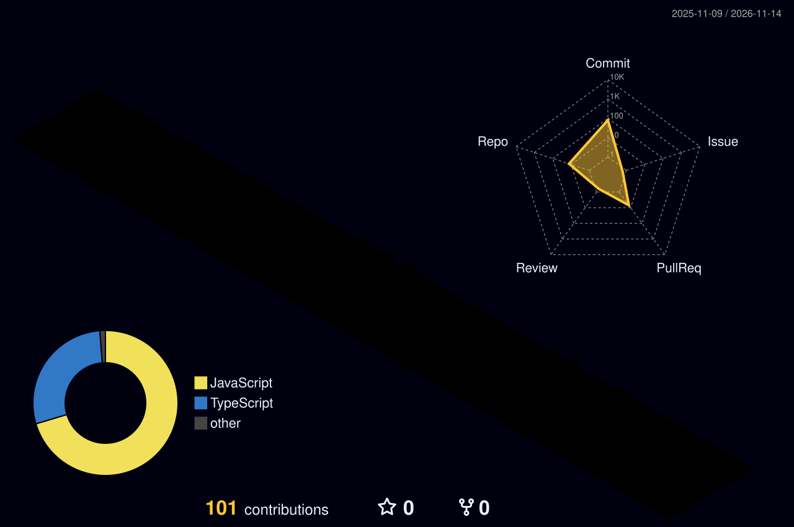

  

  
  
  

---

### `01 // SPATIAL & SYSTEM ARCHITECTURE`

> **Identity:** Md Mozammil — Systems Architect & Product Builder  
> **Core Domain:** AI Agentic Systems · 3D Spatial Web · Distributed SaaS · Autonomous Workflows  
> **Runtime:** Cloud-Native (`Groq` / `FastAPI` / `Node.js`) + Local Edge Inference (`Ollama`)

---

### `02 // CORE TECH MATRIX`

| Domain | Core Stack & Architecture |
| :--- | :--- |
| **Spatial & 3D Web** | `Three.js` · `React Three Fiber` · `TypeScript` · `Next.js` · `Tailwind CSS` |
| **AI & Orchestration** | `LangGraph` · `LangChain` · `RAG Pipelines` · `Groq SDK` · `Ollama` |
| **Backend & Data** | `Node.js` · `Express.js` · `Python` · `FastAPI` · `PostgreSQL` · `MongoDB Atlas` |
| **Tooling & Cloud** | `VS Code Extension API` · `Docker` · `Git` · `Vercel` · `CI/CD` |

---

### `03 // PRODUCTION DEPLOYMENTS`

| System | Core Architecture | Stack |
| :--- | :--- | :--- |
| **[KODEX](https://marketplace.visualstudio.com/)** | Dual-engine AI workspace extension combining ultra-fast cloud inference (Groq) and local LLM execution (Ollama) with inline diff control. | `TypeScript` `VS Code API` `Groq` `Ollama` |
| **[3D Spatial Portfolio](https://portfolio-mauve-nine-wmsmugu1iq.vercel.app/)** | Interactive 3D web showcase engineered with custom spatial shaders, camera choreography, and responsive scene physics. | `Three.js` `React Three Fiber` `Tailwind` |
| **[Restaurant & Dispatch Engine](https://github.com/Mozammilsidz9642/nfc_restaurant)** | Real-time QR table ordering, live kitchen synchronization, and automated delivery logistics platform. | `TypeScript` `React` `Node.js` `MongoDB` |
| **[Hackjudge](https://github.com/Mozammilsidz9642/Hackjudge)** | Automated hackathon submission evaluation, rubric scoring, and judging workflow platform. | `TypeScript` `Next.js` `REST API` |
| **[Audify](https://github.com/Mozammilsidz9642/Audify)** | Low-latency audio streaming engine with custom backend proxy routing and playlist state management. | `React` `Node.js` `MongoDB Atlas` |

---

### `04 // 3D ISOMETRIC CONTRIBUTION CITY`

  

